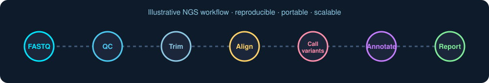

<div align="center">



<a href="https://git.io/typing-svg">
  
</a>

<br/>

[](https://zemzemfiras1.github.io/Portfolio/)
[](https://www.linkedin.com/in/firaszemzem/)
[](https://orcid.org/0009-0004-7791-6364)
[](https://www.researchgate.net/profile/Firas-Zemzem)
[](mailto:zemzemfiras@gmail.com)


</div>



## 🧬 About me

```python
class FirasZemzem:
    role        = "Bioinformatician & PhD researcher"
    based_in    = "Monastir, Tunisia 🇹🇳"
    university  = "Higher Institute of Biotechnology of Monastir"
    focus       = ["NGS analysis", "Clinical genomics", "Rare diseases",
                   "Workflow automation (Nextflow)", "Bioinformatics capacity building in Africa"]
    languages   = ["Arabic", "French", "English"]
    open_to     = "Collaborations in genomics, computational biology & interdisciplinary research"
```

- 🔬 I build **reproducible pipelines** for genomic data, from raw reads to clinically interpretable reports.
- 🌍 I train and mentor researchers across Africa as a **Nextflow Ambassador** and bioinformatics trainer.
- 🧪 I work on **rare disease genomics**, resource-limited clinical pipelines, and open-source tools.
- 📚 I study how workflow tools like Nextflow build bioinformatics capacity across the continent.


## 🛠️ Skills

<div align="center">
  
</div>

<br/>

<div align="center">


</div>

<div align="center">
  
</div>


## 🏆 Highlights

| | |
|---|---|
| 🥈 **2nd place, ASBCB Omics Codeathon (April 2024)** | **RareInsight**, an open-source interactive Shiny dashboard that improves genetic variant interpretation for rare disease research and diagnosis |
| 🌟 **Top Contributor, Nextflow Ambassador Program** | Recognised for community contributions to the Nextflow ecosystem |
| 🎤 **Best Oral Presentation, Tunisian Bioinformatics Conference** | Presented **DelMoro**, promoting accessible and reproducible workflows |
| 🎓 **Teaching Assistant, Introduction to Bioinformatics Training 2025** | Faculty of Medicine, Sfax University, with the AfriGen-D project |


## 📄 Selected publications

| Year | Title | Journal | Role |
|:---:|---|---|:---:|
| 2025 | [RareInsight simplifies the communication of genetic results for rare disease patients](https://doi.org/10.1038/s41598-025-09744-y) | *Scientific Reports* | 2nd author |
| 2026 | [Workflow management systems and reproducible pipelines for *Plasmodium*…](https://doi.org/10.1186/s12936-026-06123-4) | *Malaria Journal* | 2nd author |
| 2026 | [Socio-Genomics of Intellectual Disability in African Populations](https://doi.org/10.1007/s12687-026-00966-9) | *Journal of Community Genetics* | 1st author |
| 2026 | [Contributions of biodiversity genomics and bioinformatics to Africa's…](https://doi.org/10.1038/s41893-026-01995-5) | *Nature Sustainability* | Co-author |
| Preprint | [DelMoro pipeline for the analysis of clinical genomics data in resource-limited settings](https://dx.doi.org/10.2139/ssrn.7498249) | SSRN | 1st author |


## 🌍 Training & community

- **Nextflow Open Session**: introducing Nextflow to the Tunisian community
- **DrOmics Nextflow Training**: 4-day live workshop on workflow automation with real datasets
- **Introduction to Bioinformatics Training (IBT) 2025**: teaching assistant with AfriGen-D
- **Ensembl Train the Trainer** · **Genomics for Educators (Wellcome Connecting Science)** · **H3ABioNet Genome Sequencing Bioinformatics Course**
- ✍️ Blog: [How I became a Nextflow Ambassador](https://seqera.io/blog/how_i_became_a_nextflow_ambassador/)

> *"Firas is a dedicated Nextflow Ambassador who led impactful trainings across Africa and inspired many teams by sharing his expertise."*
> Dr. Marcel Ribeiro-Dantas, Senior Developer Advocate at Seqera


## 📊 GitHub stats

<div align="center">


</div>

### 🐍 Contribution snake

<div align="center">
  <picture>
    <source media="(prefers-color-scheme: dark)" srcset="https://raw.githubusercontent.com/Zemzemfiras1/Zemzemfiras1/output/github-snake-dark.svg"/>
    <source media="(prefers-color-scheme: light)" srcset="https://raw.githubusercontent.com/Zemzemfiras1/Zemzemfiras1/output/github-snake.svg"/>
    
  </picture>
</div>


## 🤝 Let's collaborate

I'm open to collaborations in **bioinformatics, genomics, computational biology** and interdisciplinary research. Reach out by [email](mailto:zemzemfiras@gmail.com) or on [LinkedIn](https://www.linkedin.com/in/firaszemzem/), or visit my [portfolio](https://zemzemfiras1.github.io/Portfolio/).

<div align="center">


</div>
